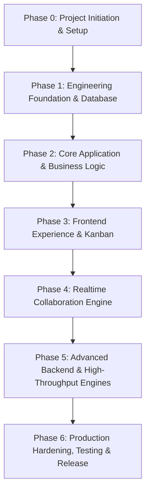

# FlowSync — Master Plan & Roadmap

## 1. Roadmap Overview (Target: 20–24 Weeks, Solo Developer)

## 2. Phase & Sprint Breakdown

### Phase 0: Project Initiation
- **Sprint 0**: Project Foundation, Governance, Monorepo Scaffolding & Local Infrastructure Setup.

### Phase 1: Engineering Foundation
- **Sprint 1**: Development Environment, Monorepo Orchestration, Health API, Frontend-Backend Handshake.
- **Sprint 2**: Database Architecture (PostgreSQL + Prisma), Centralized Validation, Error Handling, Base Entities, Swagger.

### Phase 2: Core Application
- **Sprint 3**: Authentication & Security (Argon2, JWT Access/Refresh Rotation, HttpOnly Cookies, Auth Guards).
- **Sprint 4**: Workspaces & RBAC (`OWNER`, `ADMIN`, `MEMBER`, `VIEWER`, Token-based invitations).
- **Sprint 5**: Project Management Module (CRUD, Indexing, Member Permissions, Pagination).
- **Sprint 6**: Task Management Module (CRUD, Statuses, Priorities, Comments, Complex Filter/Search).

### Phase 3: Frontend Experience
- **Sprint 7**: Next.js App Router, shadcn/ui, TanStack Query, dnd-kit Kanban Board, Optimistic UI Updates.

### Phase 4: Realtime Collaboration
- **Sprint 8**: Socket.IO Engine, Gateway Auth Handshake, Project Rooms (`project:{id}`), Live Task Reordering.
- **Sprint 9**: Live Project Chat, Message Persistence, Online Presence, In-App Notifications, Activity Audit Logs.

### Phase 5: Advanced Backend
- **Sprint 10**: Redis Caching Layer, Socket.IO Multi-node Adapter, BullMQ Background Worker (`apps/worker`), MinIO S3 Direct Presigned Uploads.
- **Sprint 11**: Streaming Excel Import/Export Engine (500k+ rows without OOM), SQL Analytics & Dashboard Aggregations.

### Phase 6: Production & Release
- **Sprint 12**: Multi-Stage Production Dockerfiles, Nginx Reverse Proxy (SSL, WebSocket Upgrades), Automated E2E/Integration Testing, GitHub Actions CI/CD, Portfolio Release v1.0.

